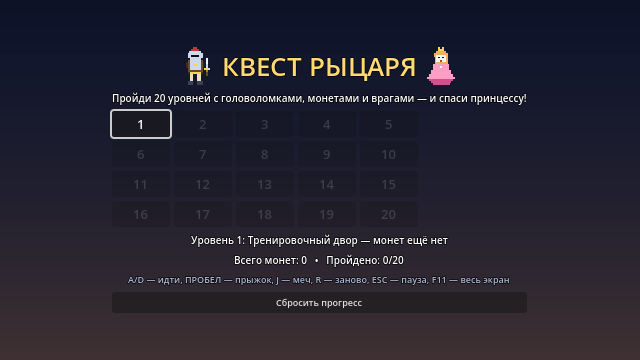
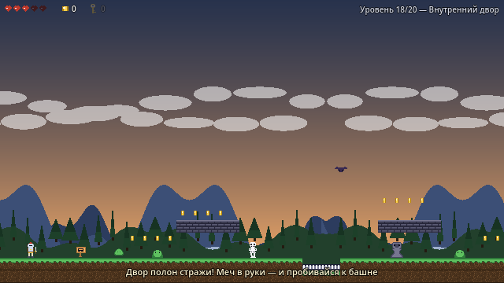
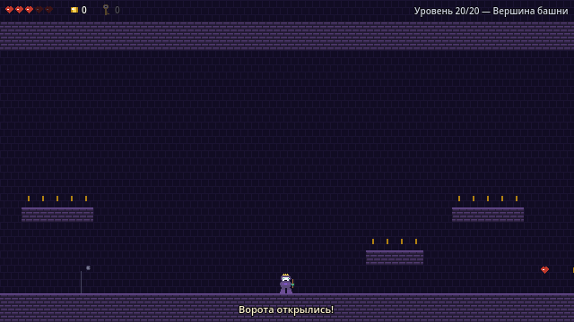
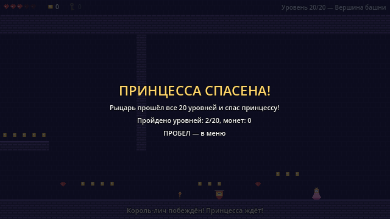

# Knight Quest — 2D-платформер на Godot 4

Рыцарь проходит **20 уровней** с головоломками, монетами и врагами, чтобы спасти принцессу.
Графика (пиксель-арт) и звук полностью сгенерированы скриптами — в проекте нет ни одного
скачанного файла.

## Как запустить

1. Установить [Godot 4.7](https://godotengine.org/download) (или новее).
2. В окне менеджера проектов нажать «Импорт», выбрать файл `knight-quest/project.godot`, затем «Импорт и изменить».
3. Нажать **F5**. Главная сцена — `scenes/Main.tscn`.

Из командной строки то же самое быстрее:

```
godot --path knight-quest
```

Готовая сборка под Windows: скачайте `KnightQuest.exe` со страницы
[релизов](https://github.com/ArenaGames120/KnightQuest/releases/latest) и запустите — устанавливать
ничего не нужно (Windows 10/11, 64 бита). Собрать самому — см. «Сборка под Windows» ниже.

## Скриншоты









## Управление

| Клавиши | Действие |
| --- | --- |
| `A` / `D` (или `←` / `→`) | идти влево / вправо |
| `ПРОБЕЛ` (или `W`, `↑`) | прыжок; держи дольше — прыжок выше |
| `J` (или `X`, `Z`) | удар мечом |
| `E` или `ПРОБЕЛ` | «дальше» на экранах победы |
| `ESC` (или `P`) | пауза |
| `R` | начать уровень заново (с начала или с чекпоинта) |
| `M` | выйти в меню |
| `F11` | полноэкранный режим |

Прыжок врагу на голову тоже убивает (кроме босса и гаргульи). Мечом можно бить не только
врагов, но и рычаги и ящики.

## Правила игры

* **Сердца** — здоровье (5 максимум). Урон дают враги и ловушки, сердечки-подбиралки лечат.
* **Монеты** — счёт и рекорды по уровням. За врагов иногда выпадают монеты.
* **Ключи** — открывают ворота с замком; один ключ открывает одни ворота.
* **Чекпоинты** — флаг сохраняет место возрождения до конца уровня.
* **Головоломки** — рычаги, нажимные плиты (нужно поставить ящик), ворота с замком,
  движущиеся платформы. Плюс смертельные шипы, пилы, лава и летящие камни.
* **Враги** — слизни, скелеты-патрульные, летучие мыши, гаргульи-каменемёты и два босса:
  «Чёрный рыцарь» (таранит, прыгает с сотрясением, призывает слуг) и финальный «Король-лич»
  (то же самое плюс залпы камней веером и две волны слуг).
* Прогресс и лучшие результаты сохраняются в `user://knight_quest_save.json`
  (уровни открываются по очереди, кнопка «Сбросить прогресс» есть в меню).

## Уровни

| № | Название | Особенности |
| --- | --- | --- |
| 1 | Тренировочный двор | обучение: бег, прыжок, меч, монеты, слизни |
| 2 | Пещеры эха | движущаяся платформа через пропасть, шипы, мыши, скелеты |
| 3 | Стражи леса | первый рычаг и ворота, чекпоинт |
| 4 | Подземный склад | ящик на нажимную плиту, пила, лава |
| 5 | Каменный мост | лава и движущиеся платформы, гаргульи, которые бьют камнями |
| 6 | Зал рычагов | два рычага, ключ и ворота с замком |
| 7 | Сторожевая башня | подъём по уступам, лифт, много монет, выход на верхнем плато |
| 8 | Кузница | пилы, лава, ящик на плиту |
| 9 | Дорога к замку | рычаг, плита, ключ и враги в одном уровне |
| 10 | Зал стражи | босс «Чёрный рыцарь»; за ним — дверь во вторую половину замка |
| 11 | Тёмный ров | два рва с лавой, платформы, гаргульи, пила |
| 12 | Катакомбы | ключ и решётка, ящик на плиту, мыши и скелеты |
| 13 | Хрустальные пещеры | платформа через лавовое озеро, пилы, шипы |
| 14 | Оружейная | два рычага и плита — трое ворот подряд |
| 15 | Мост черепов | мост над лавой: пролёты, провалы и две платформы |
| 16 | Лабиринт стражи | шипы, лавовая яма, ключ от решётки |
| 17 | Башня мага | длинный подъём по уступам, лифт, выход на верхней площадке |
| 18 | Внутренний двор | большой бой: много врагов и уступы с монетами |
| 19 | Подземная темница | два ключа, две плиты с ящиками, пилы и гаргульи |
| 20 | Вершина башни | финальный босс «Король-лич» и спасение принцессы |

## Структура проекта

```
knight-quest/
├── project.godot        настройки проекта (640x360, пиксель-арт, автозагрузка Game)
├── scenes/Main.tscn     главная сцена (весь интерфейс строится кодом)
├── scripts/
│   ├── game.gd          автозагрузка: ввод, звук, монеты/ключи/сердца, сохранение
│   ├── main.gd          меню → игра → пауза → смерть → победа → финал
│   ├── menu.gd          главное меню с выбором уровня и рекордами
│   ├── hud.gd           HUD: сердца, монеты, ключи, подсказки, панели
│   ├── levels.gd        описания всех 20 уровней (координатами)
│   ├── level.gd         сборка уровня: тайлы, объекты, головоломки, небо
│   ├── level_map.gd     парсер схем уровней (ASCII-сетка)
│   ├── player.gd        рыцарь: физика, меч, урон, смерть
│   ├── enemies/         base, slime, skeleton, bat, gargoyle, rock, boss, lich_king
│   ├── objects/         монета, сердце, ключ, ящик, ворота, рычаг, плита,
│   │                    чекпоинт, движущаяся платформа, пила, двери, принцесса
│   └── art.gd           помощник спрайтов (кадры, анимации, эффекты)
├── art/  audio/         сгенерированные спрайты (PNG) и звуки (WAV)
└── tools/               генераторы и проверки (в сборку не попадают)
```

## Как описать уровень

Уровни лежат в `scripts/levels.gd` и описываются координатами в тайлах (16x16):

```gdscript
{
    "name": "Каменный мост",
    "theme": "castle",          # forest / cave / dungeon / castle
    "bg": "castle",             # необязательно: небо отрытого уровня (forest / castle)
    "hint": "подсказка внизу экрана",
    "size": Vector2i(100, 21),  # размер карты в тайлах
    "boss": "lich",             # необязательно: knight (по умолчанию) или lich
    "boss_name": "Король-лич",  # необязательно: имя босса для подсказок
    "rects": [ {"x": 0, "y": 19, "w": 100, "h": 2, "tile": "#"} ],
    "items": [ {"t": "player", "x": 2, "y": 18}, {"t": "coin", "x": 6, "y": 17, "n": 4} ],
}
```

Символы карты (`scripts/level_map.gd`):

| Символ | Значение | Символ | Значение |
| --- | --- | --- | --- |
| `#` | земля | `o` | монета |
| `=` | камень | `j` | сердце |
| `%` `M` `W` | кладка | `k` | ключ |
| `^` | шипы | `C` | ящик |
| `v` | шипы на потолке | `H` | сундук |
| `~` | лава | `X` | чекпоинт |
| `-` `\|` | движущаяся платформа | `E` | выход с уровня |
| `P` | старт рыцаря | `p` | принцесса |
| `z` `S` `b` `T` | слизень, скелет, мышь, гаргулья | `Z` | босс («boss»: knight или lich) |
| `1`..`4` | рычаги (каналы a..d) | `A` `B` `c` `D` | ворота рычагов |
| `5`..`8` | нажимные плиты (каналы e..h) | `e` `f` `g` `h` | ворота плит |
| `K` | ворота с замком | `G` | ворота принцессы (после босса) |
| `t` `u` `F` `n` | факел, куст, знамя, табличка | `x` | пила |

Правило прыжка (проверяется валидатором): подъём до 3 тайлов, при подъёме 3 — пропасть
до 3 тайлов, при подъёме до 2 — до 4, по ровному — до 5, вниз — до 6; коридор минимум 2 тайла.

## Инструменты разработчика

Все проверки запускаются из папки с проектом (`godot` — исполняемый файл движка):

```bash
# импорт ресурсов после добавления новых файлов
godot --headless --path knight-quest --import

# перегенерировать всю графику (пиксель-арт) и звуки
godot --headless --path knight-quest --script res://tools/gen_sprites.gd
godot --headless --path knight-quest --script res://tools/gen_audio.gd

# проверить проходимость уровней (дамп карт в levels_dump.txt)
godot --headless --path knight-quest --script res://tools/check_levels.gd
godot --headless --path knight-quest --script res://tools/check_art.gd

# автоматический прогон игры: сборка всех уровней, смерть/возрождение, победа,
# монеты, рычаг, плита, ключ, босс
godot --headless --path knight-quest res://tools/TestPlay.tscn

# скриншоты (нужен оконный запуск): папка задаётся после --,
# диапазон уровней — --from=N --to=M (по умолчанию все)
godot --path knight-quest res://tools/Capture.tscn -- --shots=C:/temp/shots
godot --path knight-quest res://tools/Capture.tscn -- --shots=C:/temp/shots --from=11 --to=20
```

## Сборка под Windows

```bash
# Windows/PowerShell: путь к exe указывай абсолютным —
# относительный Godot ищет внутри папки проекта
godot --headless --path knight-quest --export-release "Windows Desktop" "$PWD/knight-quest-build/KnightQuest.exe"
```

Получается **один самодостаточный `.exe`** (около 105 МБ): ресурсы встроены внутрь
(`binary_format/embed_pck=true` в `export_presets.cfg`), иконка берётся из `icon.png`.
Готовый файл лежит в `knight-quest-build/KnightQuest.exe` — его можно скопировать куда угодно,
он не требует установленного Godot. Сохранение игры при этом пишется в
`%APPDATA%\Godot\app_userdata\Knight Quest\`.

Нужны установленные шаблоны экспорта версии 4.7.2 (редактор → «Управление шаблонами экспорта»).
Папка `tools/` в сборку не попадает.
